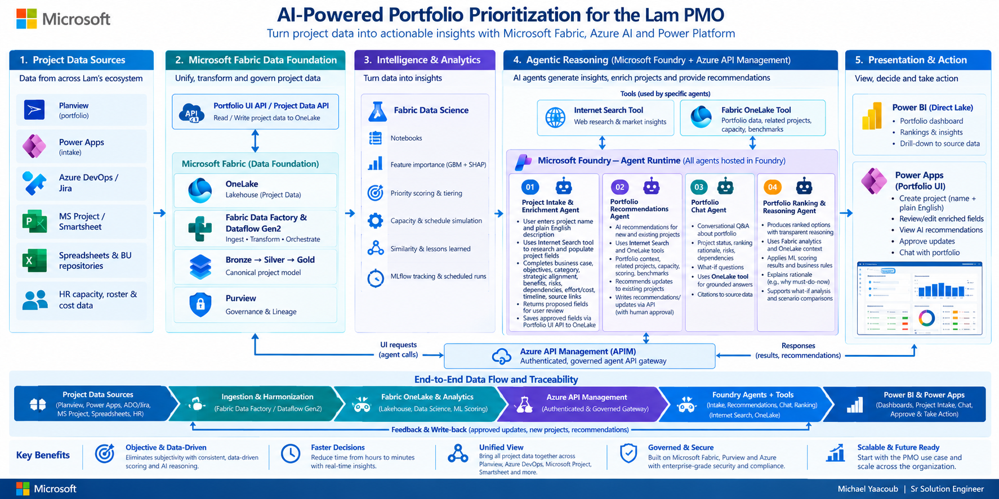
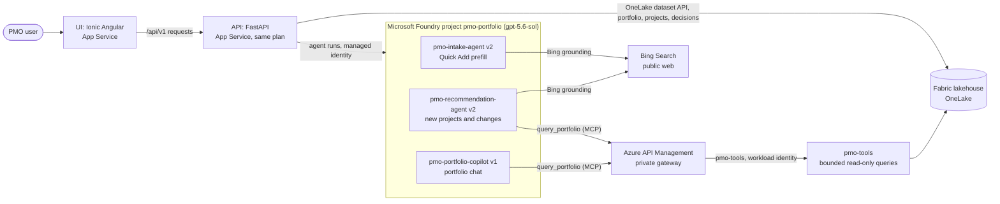

# AI-Powered PMO Portfolio Prioritization

Prioritize about 100 GIS and BU projects transparently, using existing enterprise systems: Planview, Power Apps, Azure DevOps, JIRA, MS Project, Smartsheet, BU spreadsheets and repositories, and HR capacity, roster and cost data. The solution uses Microsoft Fabric (OneLake, PySpark notebooks, LightGBM with SHAP, Direct Lake Power BI) and an Ionic Angular UI for web, tablet and mobile. Every recommendation traces back to a source record, and people approve every change.

> Crawl-stage proof of concept for the GIS PMO proposal (28 Sep 2026): "Prioritize transparently. Keep people in control."

## Table of contents

1. [Architecture](#1-architecture)
2. [Data sources and OneLake layout](#2-data-sources-and-onelake-layout)
3. [Canonical model, data quality and confidence](#3-canonical-model-data-quality-and-confidence)
4. [ML algorithms](#4-ml-algorithms)
5. [ML notebooks (PySpark)](#5-ml-notebooks-pyspark)
6. [Power BI report](#6-power-bi-report)
7. [Ionic Angular UI & AI Copilot](#7-ionic-angular-ui--ai-copilot)
8. [Rules, recommended actions and human approval](#8-rules-recommended-actions-and-human-approval)
9. [User Guide & Playwright Screenshots](#9-user-guide--playwright-screenshots)
10. [Azure Setup & Deployment Guide](#10-azure-setup--deployment-guide)
11. [Getting started](#11-getting-started)
12. [Repository layout](#12-repository-layout)
13. [Limitations and roadmap](#13-limitations-and-roadmap)
14. [Azure consumption (ACR)](#14-azure-consumption-acr)
15. [Hosted endpoints](#15-hosted-endpoints)
16. [Infrastructure as code (Bicep and Terraform)](#16-infrastructure-as-code-bicep-and-terraform)
17. [CI/CD (GitHub Actions)](#17-cicd-github-actions)
18. [Author](#18-author)

## 1. Architecture



**Reading the diagram: three Foundry agents.** All three agents are defined in one Microsoft Foundry project, `pmo-portfolio` on `foundry-myaacoub-private`, and all three use `gpt-5.6-sol`. The FastAPI API calls them with its managed identity and checks every reply against a JSON contract before the UI sees it. None of the agents writes to OneLake.

| Agent (Foundry name, version) | Role | Tools it uses | What it does |
|---|---|---|---|
| `pmo-intake-agent` (v2) | Project intake prefill | Bing grounding (public web) | Fills the Data Entry fields from a project name and a plain-English description. Each value carries an evidence level, a quote, a rationale, and a source URL. A dropdown value that its list does not have becomes a suggestion, and the user can create and apply it with one click. |
| `pmo-recommendation-agent` (v2) | Portfolio researcher | `query_portfolio` on OneLake through APIM, plus Bing grounding | Recommends new projects for each portfolio and changes to existing projects. Each item cites approved project IDs and public URLs. A person adds the project or records the decision. |
| `pmo-portfolio-copilot` (v1) | Portfolio chat | `query_portfolio` on OneLake through APIM | Answers portfolio questions from approved OneLake records and lists the project IDs it used. |

The data path is UI → API → Foundry agent → tools. OneLake tool calls leave Foundry through the private APIM gateway to the `pmo-tools` backend, which reads the approved export. Bing grounding is a Foundry-managed tool, so its calls do not pass through APIM. The API rejects a prefill or recommendation reply unless Bing was actually called, and it rejects any project citation the OneLake tool did not return. Web source URLs are checked for form only, because the Responses API does not return the search results in this configuration. The in-app page **Documentation → AI Agents & Tools** shows the same agent definitions from `ui/src/assets/config/agents.json`.

**The fourth box.** The diagram's fourth agent card, *Portfolio Ranking & Reasoning*, describes the deterministic ranking that runs in the Fabric notebooks (LightGBM, SHAP, and rules). It is not a Foundry agent, so this solution deploys three.

**Runtime data flow.** Bing grounding runs inside Foundry and reaches the public web directly, without APIM. OneLake tool calls leave Foundry through the private APIM gateway.



### ML algorithms: end-to-end project walkthrough


These supplied diagrams are illustrative, not live results. Production inference
uses calibrated LightGBM; logistic regression is a baseline, SHAP explains model
outputs, and KMeans groups similar projects. Confidence uses completeness,
quality, and model certainty, not the walkthrough's example model consensus.
Rules are deterministic and Planview write-back is not implemented.
See [the architecture guide](docs/ARCHITECTURE.md) for the implemented notebook
flow, governed Foundry tool sequence, and private-enterprise deployment gates.

The UI's **Documentation → Project Fields** page (immediately after Architecture)
lists every intake field with type, mandatory/optional status, permitted values,
limits, description and example. Model signals are ordered using available
exported absolute SHAP shares; policy gates are identified separately.
These percentages are measured attribution shares, not fixed priority-score weights.

The solution follows the five-layer architecture from the proposal. Evidence flows forward: each ranked project keeps a link back to the source rows that produced its signals (`silver.signal_provenance`).

| Layer | What it covers | How this repo implements it |
|---|---|---|
| 1. Project data sources | Planview, Power Apps intake, Azure DevOps and JIRA, MS Project and Smartsheet, spreadsheets and BU repositories, HR capacity, roster and cost data | Eleven raw extracts plus an Excel intake template, generated by [data-generator](data-generator/) and uploaded to `Files/raw/<source>/` in the lakehouse. Each source keeps its own native schema. |
| 2. Data foundation (Fabric) | OneLake lakehouse, medallion layers, governance | `pmo_lakehouse` (schema-enabled). One `src_<source>` schema per source, then `silver` (canonical 10-signal model with provenance) and `gold` (features, predictions, explanations, metrics). Ingestion and normalization run in PySpark inside notebook 01. |
| 3. Intelligence (Fabric Data Science) | Notebooks, feature importance (GBM + SHAP), priority scoring and tiering, capacity, similarity, MLflow tracking | Two PySpark notebooks in the **ML Notebooks** folder. Notebook 01 trains and explains the model. Notebook 02 runs batch inference. MLflow tracks experiments. |
| 4. Agentic reasoning | Evidence-based explanations, configurable business rules, human approval | Three Foundry agents: intake prefill (Bing grounding), recommendations (OneLake through private APIM and Bing grounding), and portfolio chat (OneLake through private APIM). The backend validates every reply. Policy rules remain deterministic and separate from generated explanations. See [architecture](docs/ARCHITECTURE.md). |
| 5. Presentation and action | Power BI (Direct Lake) and Power Apps intake | The Power BI report on the gold tables is planned and not part of this build. An Ionic Angular app for web, tablet and mobile with filters, confidence levels, grouping, and approve, adjust or reject decisions. Power Apps write-back is not part of this build. |

Flow: **sources → normalize (PySpark) → score and explain (LightGBM, SHAP, calibration, KMeans) → rules and confidence → Power BI and UI → PMO decision (human approval)**.

## 2. Data sources and OneLake layout

Synthetic but realistic data for 100 projects (`GIS-0001` to `GIS-0100`). Each project appears in a random subset of sources, so some projects are missing data from several systems. Twenty projects exist only in the Excel intake template, which holds the ten candidate signals from the proposal. Messy formats are included on purpose (currency strings, `Last, First` names, `dd-MMM-yy` dates, fiscal quarters, duplicate intake resubmissions) to exercise normalization.

| Source (OneLake folder) | Native format | Lakehouse schema | Main contribution |
|---|---|---|---|
| Planview portfolio (`planview`) | CSV | `src_planview` | Benefit score, cost, risk, dependencies, skill demand, protected flag |
| Power Apps intake (`powerapps`) | Dataverse-style JSON | `src_powerapps` | Sponsor level, business value, regulatory flag, DT initiative, target go-live |
| Azure DevOps (`ado`) | Work-item CSV | `src_ado` | Story points, tags, target dates |
| JIRA (`jira`) | Search API JSON | `src_jira` | Story points, sprints, Blocks links (dependencies) |
| MS Project (`ms_project`) | MSPDI XML (4 programs) | `src_ms_project` | Effort (work hours), predecessors |
| Smartsheet (`smartsheet`) | Sheet CSV | `src_smartsheet` | Go-live milestone, RAG status |
| BU trackers (`spreadsheets`) | Multi-sheet XLSX with title rows | `src_spreadsheets` | Budget ($K), fiscal go-live, regulatory flag, dependency codes. Also the PMO decision history used as training labels. |
| BU repositories (`bu_repositories`) | Document index JSON | `src_bu_repos` | Compliance tags, open risks, dependency register |
| HR capacity (`hr_capacity`) | Long-format CSV | `src_hr_capacity` | Allocation by skill and phase |
| HR roster (`hr_roster`) | CSV | `src_hr_roster` | Sponsor seniority, skill supply |
| Finance cost (`cost`) | Monthly CSV | `src_cost` | Budget totals |
| Excel intake (`excel_intake`) | XLSX template | `src_excel_intake` | The ten candidate signals for Excel-only projects |

Ground-truth values are hidden from the lake. Labels for training come only from the PMO decision history, with 10% label noise to mimic review inconsistency.

## 3. Canonical model, data quality and confidence

Each of the ten candidate signals resolves from the first available source in a documented precedence order, and the chosen source is written to `silver.signal_provenance`.

| # | Signal (proposal slide 3) | Canonical field | Example precedence |
|---|---|---|---|
| 1 | Timing urgency | `go_live_date` | Planview > Smartsheet milestone > Power Apps > Excel |
| 2 | Business value | `business_value` (1-5) | Planview benefit score > Power Apps High/Medium/Low > Excel |
| 3 | Sponsor priority | `sponsor_priority` (1-4) | Roster job title of the sponsor > Power Apps sponsor level > Excel |
| 4 | Regulatory or security | `regulatory_security` | Power Apps > Excel > BU compliance tags |
| 5 | Skill or phase demand | `skill_demand` | Planview > HR allocations > Excel |
| 6 | Cost | `cost_usd` | Finance budget > Planview > Power Apps > BU tracker > Excel |
| 7 | Dependencies | `dependencies` | BU dependency register > BU tracker > Planview > JIRA links > Excel |
| 8 | Risk | `risk` (1-4) | Planview > BU risk register > Smartsheet RAG > Excel |
| 9 | DT alignment | `dt_alignment` | Power Apps > Planview tag > ADO or JIRA label > Excel |
| 10 | Effort | `effort_person_weeks` | MS Project work hours / 40 > Excel > story points x 0.5 |

**Data quality checks.** Ten checks cover date ranges, value ranges, roster matching, code validity, and cross-source consistency (go-live within 45 days, cost within 25%). A check runs only when its input exists.

**Confidence score (0-100).** Each project's score combines three parts:

`confidence = 100 x (0.45 x completeness + 0.35 x quality + 0.20 x model certainty)`

- **Completeness**: signals resolved out of 10.
- **Quality**: passed checks out of evaluated checks.
- **Model certainty**: maximum calibrated class probability (Platt scaling).

Levels: **High** at 75 or more, **Medium** from 50 to 74.9, **Low** below 50.

## 4. ML algorithms

<!-- ML_TABLE_START -->
| Algorithm | What it does | Most important feature | Output table in OneLake | Sample output (GIS-0001) | Algo used |
|---|---|---|---|---|---|
| LightGBM multiclass tier classifier | Learns the four PMO tiers (Must-do-now, Proceed, Can wait, Candidate to deprioritize) from 70 labelled decisions and gives each project a probability for each tier. The probabilities are calibrated with `CalibratedClassifierCV`. 5-fold cross-validation: accuracy 0.514, macro F1 0.415, log loss 2.08. | Business value. It is the largest SHAP driver for the sample project. | `gold.project_features` (inputs), `gold.model_metrics` (CV scores), `gold.project_predictions` (scores) | Tier **Can wait**, probability 0.48, priority score 48.4 | `LGBMClassifier` in notebook 01 (`05_features_train`). Scoring in notebook 02 (`01_load_score`). |
| Logistic regression baseline | Simpler reference model on the same features, used to check that LightGBM adds value. 5-fold cross-validation: accuracy 0.486, macro F1 0.427, log loss 3.66. | Same features as the main model | `gold.model_metrics` | Not used for predictions | `LogisticRegression` pipeline in notebook 01 (`05_features_train`) |
| SHAP explanations (LightGBM `pred_contrib`, TreeSHAP) | Shows which signals pushed each project toward or away from its predicted tier. This run wrote 1,000 project-tier rows. | Business value, Effort, Timing urgency, Cost | `gold.project_shap_drivers` | Top drivers: Business value +2.87, Effort +1.54, Timing urgency +1.52, Cost +0.74 | Notebook 02 (`01_load_score`, `03_outputs`) |
| KMeans clustering (k = 5) | Groups projects with similar signal profiles so the PMO reviews them together. Each cluster is named from its strongest signals. | Cluster name, taken from the top signals in each group | `gold.project_clusters` | Cluster: Sponsor priority and DT alignment | `sklearn.cluster.KMeans` in notebook 02 (`03_outputs`) |
| Confidence score (weighted rules, not ML) | Combines completeness (sources present), data quality (checks passed), and model certainty into a 0 to 100 score. High is 75 or more, Medium 50 to 74.9, Low below 50. | Completeness and data quality | `gold.project_predictions` (`confidenceScore`, `confidenceLevel`) | Score 86, High (completeness 1.0, quality 0.9) | Notebook 02 (`02_rules_confidence`) |
| Decision rules R1 to R5 (deterministic) | Override the model where policy applies. Rules fired in this run: R1 regulatory first (12), R3 protected program (2), R4 deprioritize guard (1), R5 cross-portfolio critical path (3). | Policy flags: regulatory, protected program, DT alignment | `gold.pmo_rules`, `gold.rule_triggers` | Rules fired this run: R1 12, R3 2, R4 1, R5 3 | Notebook 02 (`02_rules_confidence`) |
<!-- ML_TABLE_END -->

## 5. ML notebooks (PySpark)

Both notebooks sit in the **ML Notebooks** folder of the `PMO-Portfolio-Prioritization` workspace and run on the Fabric Spark runtime against `pmo_lakehouse`.

- **`01_PMO_Feature_Engineering_Training`**: ingests all sources into `src_*` schemas, normalizes them into `silver`, runs data-quality checks, builds features, trains and calibrates the tier classifier, computes SHAP and clusters, and logs everything to MLflow.
- **`02_PMO_Inference_Predictions`**: loads the registered model, scores all projects with `mapInPandas`, applies the rules, computes confidence and priority, writes `gold.project_predictions`, and exports `portfolio.json` for the UI.

Run order: 01, then 02. Source parts are in [fabric/ml-notebooks/](fabric/ml-notebooks/). `fabric/scripts/build_notebooks.py` builds the `.ipynb` files, and `fabric/scripts/deploy_fabric_items.py` deploys them.

## 6. Power BI report

Not part of this build. The planned report is **PMO Portfolio Prioritization** on a Direct Lake semantic model over the `gold` schema. The UI reads the same gold data through the API, so the decisions match. Adding the report is the next step.

## 7. Ionic Angular UI & AI Copilot

[ui/](ui/) is a high-fidelity Ionic Angular application engineered for high-impact executive presentation, with layout optimizations across all device form factors:

- **Browser / Desktop (1200 px and up)**: 3-column architecture featuring collapsible left navigation, sticky facet filter panel, live KPI row, six interactive charts (priority mix, confidence by business unit, investment by site, organizational priorities, skill capacity, and information readiness), Board, Hierarchy and sortable Table views, and a slide-out Project Detail Inspector with priority-factor explanations.
- **Tablet (768 to 1199 px)**: 2-column responsive layout with slide-in filter drawer, 2x2 touch-friendly KPI cards, and bottom-sheet project inspector.
- **Mobile (below 768 px)**: Single-column fluid stack with mobile drawer menu, touch-optimized filter button, swipeable board cards, and full-screen detail sheets.
- **No mock data in the UI**: every screen reads portfolio data, options, decisions, and lifecycle changes through the API from OneLake. The demo dataset is synthetic (100 projects, `GIS-0001` to `GIS-0100`), and every page shows a banner saying so while the Demo Environment setting is on (Admin Settings).
- **Business-friendly operational screens**: storage is called the **database**; priority assessments, business rules, and analysis refreshes replace implementation jargon. Architecture/Agents documentation and this repository retain technical details. System-message terminology is configured in [business-language.json](ui/src/assets/config/business-language.json); actual project names and source evidence are not renamed.
- **Overview chart guidance**: all six chart cards show a short sentence beneath the title. Expand **More detail and an example** for reading guidance and an explicitly illustrative example, not generated portfolio results. Titles, explanations, and examples are configured in [overview-charts.json](ui/src/assets/config/overview-charts.json). Capacity uses saved portfolio-wide totals, not the current project filters.
- **Saved AI recommendations with automatic refresh**: entering AI Recommendations loads the last successful report from OneLake while independently requesting a fresh agent report. The saved report keeps its original generation time and remains visible if the refresh fails. Reports are isolated by portfolio and research question; a demo reset starts a new cache namespace. `GET /v1/recommendations/cached` never invokes an agent, and fresh generation persists only valid, grounded reports in the folder configured in [recommendations.json](config/recommendations.json).
- **Demo-only project replacement**: Data Entry → Import & Uploads offers load-all, portfolio-only load, and clear-all controls when the saved global demo setting is enabled. Each operation requires confirmation and the API rechecks demo mode before writing. Full load replaces all projects; portfolio load replaces only that portfolio; repeat loads do not duplicate projects. Original entries, source data, and audit records are retained. Production mode rejects these operations.
- **AI Portfolio Copilot (Agent FAB)**: Floating Action Button in the lower-right corner with a gradient glow and pulse effect. Clicking opens the Copilot chat drawer with:
  - Starter prompts set in `ui/src/assets/config/ui.json` (`copilot.samplePrompts`), for example *Top 5 Must-Do-Now Projects*, *Budget by Business Unit*, and *Skills Capacity Deficits*.
  - Multi-view answers: seamlessly switch between **Data Table** and **Interactive Chart**.
  - Chart type switcher: toggle between **Bar**, **Line**, **Pie / Donut**, and **Radar / Spider** charts.
  - Multi-format document export buttons: export any result directly to **Word (.docx)**, **Excel (.xlsx)**, or **PowerPoint (.pptx)**.

The approved demo source is a separate, verified OneLake JSON snapshot of the original 100 synthetic projects and their Fabric-produced scores. Publish it from [api/](api/) with `uv run python -m tools.publish_demo_snapshot --confirm-synthetic`; this creates the source only, without changing active projects. Its ID/name check uses the deterministic repository generator and records any missing names restored from that generator. Snapshot and reset paths are configured in [api.json](api/config/api.json).

API publication also registers missing APIM operations from the configured OpenAPI document, including cached recommendations, demo controls, and lifecycle/import routes. Existing operations and their policies are preserved; no wildcard gateway operation or network-access change is introduced.

Lifecycle/demo changes are API overlays; the existing Fabric inference pipeline does not yet consume those overlays. Loading demo projects therefore preserves captured scores rather than recalculating them. After a demo reset, old aggregate capacity and cluster summaries are suppressed and capacity scenarios return an explicit unavailable response instead of showing totals for the previous project set. No new SQL database is introduced: persisted reports, settings, and reset snapshots remain OneLake JSON documents.

Header: Microsoft 4-square logo, app title, subtitle, and live as-of date. Footer: Michael Yaacoub | Sr Solution Engineer with LinkedIn and GitHub links.

Filtering and prioritization:
- Confidence level chips (High, Medium, Low) with live counts, plus the other filters: tier, business unit, site, sponsor level, risk, skill, cluster, action, regulatory, DT alignment, protected program, data issues, sources present, completeness, priority, cost, and go-live window.
- Search, sort, group-by (tier, confidence, business unit, cluster, action), shortlist, saved views, and CSV export.
- Decisions (approve, adjust, reject) require a mandatory justification and are logged with an immutable audit trail.

## 8. Rules, recommended actions and human approval

- **R1 Regulatory first**: regulatory or security flag and go-live within 18 months elevates project to **Must-do-now**.
- **R2 Executive sponsorship**: executive sponsor and business value of 4 or more lifts Can wait or Candidate to deprioritize to **Proceed**.
- **R3 Protected program**: protected strategic programs lock priority slots and prevent deferral.
- **R4 Deprioritize guard**: active projects within 6 months of go-live cannot be deprioritized without VP escalation.
- **R5 Cross-portfolio critical path**: projects with 3 or more cross-portfolio dependencies highlight coupling and require synchronized scheduling.

Rules live in `gold.pmo_rules`, allowing PMO customization. Recommended actions map to the proposal's levers: **Protect slot** or **Add capacity** (Must-do-now), **Proceed**, **Re-sequence** (Can wait), and **Pause or divert skills** (Candidate to deprioritize). Every action requires human approval.

## 9. User Guide & Playwright Screenshots

A complete, high-fidelity user guide is published with automated high-resolution screenshots captured across Desktop, Tablet, and Mobile devices using Playwright:

- 📖 **Markdown User Guide**: [`docs/USER_GUIDE.md`](docs/USER_GUIDE.md)
- 📑 **Printable PDF User Guide**: [`docs/USER_GUIDE.pdf`](docs/USER_GUIDE.pdf)
- 📸 **High-Resolution Screenshots Directory**: [`docs/images/user-guide/`](docs/images/user-guide/)

### Screenshots Captured by Playwright:
| Screen / Feature | Viewport | Screenshot File |
|---|---|---|
| Executive Overview | Desktop (1920x1080) | [`01-overview-desktop.png`](docs/images/user-guide/01-overview-desktop.png) |
| Executive Overview | Tablet (820x1180) | [`01-overview-tablet.png`](docs/images/user-guide/01-overview-tablet.png) |
| Executive Overview | Mobile (390x844) | [`01-overview-mobile.png`](docs/images/user-guide/01-overview-mobile.png) |
| Prioritization Board View | Desktop (1920x1080) | [`02-prioritization-board.png`](docs/images/user-guide/02-prioritization-board.png) |
| Prioritization Board View | Mobile (390x844) | [`02-prioritization-mobile.png`](docs/images/user-guide/02-prioritization-mobile.png) |
| Prioritization Table View | Desktop (1920x1080) | [`03-prioritization-table.png`](docs/images/user-guide/03-prioritization-table.png) |
| Organizational Hierarchy Rollups | Desktop (1920x1080) | [`04-hierarchy-rollups.png`](docs/images/user-guide/04-hierarchy-rollups.png) |
| Power BI Direct Lake Analytics | Desktop (1920x1080) | [`05-powerbi-directlake.png`](docs/images/user-guide/05-powerbi-directlake.png) |
| Quick Add with AI Prefill | Desktop (1920x1080) | [`06-quick-add-prefill.png`](docs/images/user-guide/06-quick-add-prefill.png) |
| Data Entry & Ingestion Sources | Desktop (1920x1080) | [`07-data-entry-ingestion.png`](docs/images/user-guide/07-data-entry-ingestion.png) |
| PMO Decisions & Governance Log | Desktop (1920x1080) | [`08-pmo-decisions-log.png`](docs/images/user-guide/08-pmo-decisions-log.png) |
| Project Detail & SHAP Drivers | Desktop (1920x1080) | [`09-project-detail.png`](docs/images/user-guide/09-project-detail.png) |
| AI Portfolio Copilot Agent FAB | Desktop (1920x1080) | [`10-ai-copilot-agent-fab.png`](docs/images/user-guide/10-ai-copilot-agent-fab.png) |

To re-run the automated Playwright capture script at any time:
```powershell
cd ui
node scripts/capture_guide.mjs
```

## 10. Azure Setup & Deployment Guide

For full architecture diagrams, Azure resource breakdowns, and exact deployment commands, see:

- 🚀 **Full Azure Setup & Deployment Guide**: [`SETUP_GUIDE.md`](SETUP_GUIDE.md) or [`docs/SETUP_GUIDE.md`](docs/SETUP_GUIDE.md)

### Azure Services Used:
1. **Microsoft Fabric (OneLake Lakehouse)**: Medallion delta parquet lakehouse (`src_*`, `silver.signal_provenance`, `gold.pmo_predictions`), PySpark ML notebooks, and Fabric Pipelines.
2. **Direct Lake Power BI**: Zero-copy semantic model connecting directly to `gold.pmo_predictions`.
3. **Azure App Service (Linux)**: Hosts the Ionic Angular SPA frontend and FastAPI backend.
4. **Azure API Management (APIM)**: Exposes endpoints under `/pmo` with subscription key security (`Ocp-Apim-Subscription-Key`).
5. **Azure Key Vault**: Stores APIM subscription secrets, integrated via private endpoints and Managed Identity.
6. **Microsoft Foundry (Azure AI)**: `gpt-5.6-sol` agents for Quick Add prefill (Bing grounding), recommendations (OneLake and Bing), and the PMO chat (OneLake).
7. **Azure Monitor & Application Insights**: Centralized logging, distributed tracing, and live telemetry.
8. **Microsoft Entra ID**: Managed Identity authentication and Entra App Registration for Power BI MSAL embedding.

### Deployment Quick Steps:
```powershell
# 1. Sign in to Azure
az login
az account set --subscription "cf824570-a8ba-497a-a184-0a52f1830aa9"

# 2. Ingest raw data to OneLake
python data-generator/generate_pmo_data.py
python data-generator/upload_to_onelake.py

# 3. Deploy Fabric Notebooks & Pipeline
python fabric/scripts/build_notebooks.py
python fabric/scripts/deploy_fabric_items.py

# 4. Deploy Azure Infrastructure (Bicep or Terraform)
pwsh infra/scripts/deploy.ps1 -IacTool bicep -Mode infra

# 5. Deploy Applications (API & UI)
pwsh infra/scripts/deploy.ps1 -Mode deploy -Component both
```

## 11. Getting started

Prerequisites: Python 3.12 with [uv](https://docs.astral.sh/uv/), Node.js 22, PowerShell 7, and the Azure CLI signed in to the tenant (`az login`) with access to the Fabric workspace.

```powershell
# 1. Generate the synthetic sources into data/ and upload them to OneLake (Files/raw/<source>/)
cd data-generator
uv sync --frozen
uv run python generate_pmo_data.py
uv run python upload_to_onelake.py
cd ..

# 2. In Fabric, run notebook 01, then notebook 02 (ML Notebooks folder), or run the PMO Full Pipeline

# 3. Run the API locally (Swagger UI at http://127.0.0.1:8000/docs)
cd api
uv sync --frozen
uv run uvicorn app.main:app --port 8000
cd ..

# 4. Run the UI (http://localhost:4200)
cd ..\ui
npm install
npm start
```

## 12. Repository layout

```
README.md                    This file
docs/images/                 Architecture diagram
docs/ACR-README.md           Azure consumption report by service and environment (generated)
data-generator/              Python generator and OneLake uploader (uv project)
data/                        Generated source extracts, one folder per source
fabric/ml-notebooks/         PySpark notebooks 01 and 02 (source parts, built to .ipynb)
fabric/scripts/              Notebook build and Fabric deploy scripts
config/                      Shared JSON settings (data entry, portfolios, ML, AI prefill, Fabric items, CI)
api/                         Python FastAPI service (OneLake data, quick add, AI prefill)
ui/                          Ionic Angular app (ui/www is the build output)
ui/server/                   Python host that serves the UI and proxies /api through APIM
infra/bicep/                 Bicep template and parameters
infra/terraform/             Terraform configuration with the same resources
infra/config/                Deployment contract: names, reused resources, endpoints
infra/scripts/               deploy.ps1: validate, plan, deploy infrastructure, publish apps
.github/workflows/           One workflow per component, each with path filters
```

## 13. Limitations and roadmap

- **Synthetic data.** Names, costs, dates and outcomes are generated. Results show how the method works, not measured enterprise outcomes.
- **Walk and Run stages.** Similarity and lessons learned (embeddings), Copilot Studio, Power Apps intake and approval workflow, Teams Q&A, and capacity or schedule what-if simulation are not in this build.
- **Governance.** Microsoft Purview is not configured in this demo.
- **Ingestion.** Ingestion runs in PySpark inside notebook 01. Dataflow Gen2 or Data Factory pipelines are the production option for scheduled loads.
- **Write-back.** Approved decisions are stored locally in the UI. Write-back to Planview or intake is a later step.
- **Power BI.** The report and semantic model are planned and not built in this demo.
- **Foundry agents.** Three versioned agents run in Foundry. Chat uses native read-only OneLake MCP retrieval through private APIM. Quick Add prefill and recommendations use Bing grounding, and recommendations also use OneLake. Fabric's general-purpose data-agent service and per-user RLS are not implemented.
- **Terraform state.** Local state for now. Configure a remote backend before sharing a Terraform deployment.
- **One IaC flavor per environment.** Bicep and Terraform both create the APIM API with path `pmo`, so deploy only one of them to an environment.
- **Network.** The shared APIM and Key Vault disable public access. The UI App Service reaches both through VNet integration (`genie-obo-integration`) and private endpoints. The API App Service accepts public traffic. Restricting the API to APIM is a hardening step.
- **Key Vault policy.** The environment policy `KeyVault_PublicNetwork_Modify` forces Key Vault to private access, so the deployment adds a private endpoint for the vault instead of relying on public access.
- **Quick add.** Submit writes the project to OneLake and can start the pipeline. It has not been run end to end in this demo.

## 14. Azure consumption (ACR)

Monthly Azure spend for the resource group that hosts this solution, broken down by service and by environment (dev, test, prod). The full table, totals summary, and notes are in [docs/ACR-README.md](docs/ACR-README.md).

Latest figures (September 2026, actual cost, USD): total **$892.67** across 19 services. Largest service: API Management at $506.30. Environment split: Dev $0.09, Test $92.97, Prod $1.57, Unassigned $798.04.

Regenerate with `node scripts/cost/generate-acr-readme.mjs --config config/consumption.json`. Scope, period, and tag mapping live in [config/consumption.json](config/consumption.json).

## 13. Hosted endpoints & published URLs

Deployed to resource group `m365-myaacoub` in subscription `cf824570-a8ba-497a-a184-0a52f1830aa9`. Both the Python API and Ionic UI Web Apps are hosted on the **same App Service Plan** (`caldova-tokenomics-api-plan`). App Services and the Foundry project are in West US 2 and West US, APIM is in West US.

### Published URLs & API Documentation

- **Interactive API Swagger UI:** [https://azapittlyg2gcvfsso.azurewebsites.net/docs](https://azapittlyg2gcvfsso.azurewebsites.net/docs)
- **API Base URL (Direct):** [https://azapittlyg2gcvfsso.azurewebsites.net](https://azapittlyg2gcvfsso.azurewebsites.net)
- **API OpenAPI Specification:** [https://azapittlyg2gcvfsso.azurewebsites.net/openapi.json](https://azapittlyg2gcvfsso.azurewebsites.net/openapi.json) (also committed in [docs/api/openapi.json](docs/api/openapi.json))
- **OneLake dataset API:** [https://azapittlyg2gcvfsso.azurewebsites.net/v1/onelake/datasets](https://azapittlyg2gcvfsso.azurewebsites.net/v1/onelake/datasets)
- **API via APIM Gateway:** `https://caldova-apim-westus.azure-api.net/pmo` (protected by APIM subscription key over private VNet)
- **Web Application (UI):** [https://azuittlyg2gcvfsso.azurewebsites.net](https://azuittlyg2gcvfsso.azurewebsites.net)

| Component | URL or location | Notes |
|---|---|---|
| Web Application (UI) | https://azuittlyg2gcvfsso.azurewebsites.net | Single-page application hosted on `caldova-tokenomics-api-plan`. |
| API Base URL (direct) | https://azapittlyg2gcvfsso.azurewebsites.net | Python FastAPI backend hosted on `caldova-tokenomics-api-plan`. Health at `/v1/health`. |
| API Swagger Documentation | https://azapittlyg2gcvfsso.azurewebsites.net/docs | Interactive Swagger UI documentation with all schemas and try-it-out. |
| API OpenAPI Specification | https://azapittlyg2gcvfsso.azurewebsites.net/openapi.json | Machine-readable OpenAPI 3.1 specification. |
| OneLake dataset API | https://azapittlyg2gcvfsso.azurewebsites.net/v1/onelake/datasets | Lists the datasets the UI reads and updates. Writes need the ETag from the last read. Allowlist: `config/onelake-datasets.json`. |
| API through APIM | https://caldova-apim-westus.azure-api.net/pmo | Needs the `Ocp-Apim-Subscription-Key` header. The gateway is private (public access is disabled), so the UI host reaches it over VNet integration and adds the key from Key Vault. |
| OneLake MCP through APIM | https://caldova-apim-westus.azure-api.net/pmo-onelake/mcp | Private gateway. Called by Foundry through the `pmo-onelake-apim` project connection (managed identity, `Portfolio.Query`), not by browsers. |
| Foundry agent endpoint | https://foundry-myaacoub-private.services.ai.azure.com/api/projects/pmo-portfolio | Project endpoint for `pmo-portfolio-copilot:1` (chat), `pmo-intake-agent:2` (Quick Add prefill), and `pmo-recommendation-agent:2` (recommendations). |
| Fabric workspace | https://app.fabric.microsoft.com/groups/39c02d65-d2cb-4355-9e77-cbf442d7fc8b | `PMO-Portfolio-Prioritization`. The ML Notebooks folder holds notebooks 01 and 02. |
| Lakehouse | https://app.fabric.microsoft.com/groups/39c02d65-d2cb-4355-9e77-cbf442d7fc8b/lakehouses/44a0e48d-ed47-4d30-8e1e-6db662ea9324 | `pmo_lakehouse`. OneLake is the only data store. |
| Foundry project | https://portal.azure.com/#resource/subscriptions/cf824570-a8ba-497a-a184-0a52f1830aa9/resourceGroups/m365-myaacoub/providers/Microsoft.CognitiveServices/accounts/foundry-myaacoub-private/projects/pmo-portfolio/overview | Three pinned agents (see Foundry agents below), the existing `gpt-5.6-sol` deployment, native OneLake MCP through private APIM for chat and recommendations, and Bing grounding for prefill and recommendations. |
| Key Vault | azkvttlyg2gcvfsso | Holds the APIM subscription key as `apim-subscription-key`. |
| Application Insights | azaittlyg2gcvfsso | Telemetry for both App Services. |

## 14. Infrastructure as code (Bicep and Terraform)

### Foundry agents, Bing grounding, and the OneLake API

Three agents run in one Foundry project, `pmo-portfolio`. Each definition is a JSON file in [api/config/](api/config/), and [infra/scripts/create-portfolio-agent.ps1](infra/scripts/create-portfolio-agent.ps1) provisions them:

| Definition | Agent | Version | Tools |
|---|---|---|---|
| [portfolio-agent.json](api/config/portfolio-agent.json) | `pmo-portfolio-copilot` (chat) | 1 | `query_portfolio` on OneLake through APIM |
| [recommendation-agent.json](api/config/recommendation-agent.json) | `pmo-recommendation-agent` (recommendations) | 2 | `query_portfolio` on OneLake through APIM, Bing grounding |
| [intake-agent.json](api/config/intake-agent.json) | `pmo-intake-agent` (Quick Add prefill) | 2 | Bing grounding |

To set up a new environment, create the Bing connection first, then the agents:

```powershell
./infra/scripts/create-bing-connection.ps1   # Grounding with Bing Search connection; prints no key
./infra/scripts/create-portfolio-agent.ps1   # creates any agent that does not exist yet
```

The agent script skips agents that already exist. Add `-CreateNextVersion` only to publish the next immutable version of an existing agent after you change its definition and pin the new version. The Bing script reads the subscription and resource group from [pmo-deployment.json](infra/config/pmo-deployment.json), the Foundry project from [portfolio-agent.json](api/config/portfolio-agent.json), and the connection settings from [bing-grounding.json](infra/config/bing-grounding.json). It warns if an agent references a different connection ID.

The API checks every agent reply before the UI sees it. A prefill or recommendation reply must show that Bing was called. A recommendation reply may cite only projects that the OneLake tool returned in that run, and a decision action must target one of them. A malformed source URL is dropped, not shown.

#### OneLake dataset API for the UI

The UI reads and writes OneLake through `/v1/onelake`, never directly. [config/onelake-datasets.json](config/onelake-datasets.json) is the allowlist. A client names a dataset by key and never supplies a path.

- `GET /v1/onelake/datasets` lists the datasets, with their shape, access, required fields, and size limit.
- `GET /v1/onelake/datasets/{key}` returns the data and its ETag, both as the `ETag` header and in the body.
- `PUT /v1/onelake/datasets/{key}` replaces a `readWrite` dataset. Once the dataset exists, the request must send that ETag in `If-Match` (428 otherwise). A change made since the read returns 409 and is not overwritten. Every record must have each required field, and the body must fit the size limit.

System settings and priority weights are the two `readWrite` datasets. Their admin pages keep their own validated endpoints, which read and write the same tables. A OneLake error is reported as an error, never replaced by a default.

### Portfolio Copilot: real Foundry agent

Chat uses `POST /api/v1/agent/chat` on the UI host. Its server-side proxy adds
the APIM subscription key and forwards to `/pmo/v1/agent/chat`; the API invokes
the versioned Foundry agent. Foundry automatically executes `query_portfolio`
through the private APIM `pmo-onelake/mcp` endpoint using its project managed
identity. APIM exposes only the bounded `pmo-tools` REST query as an MCP tool.
The adapter reads the approved OneLake portfolio
export and returns bounded, projected evidence, not the complete snapshot.
No chat answers are generated locally and no
sample-data fallback is used. A missing export, unavailable Foundry service,
invalid response, or missing permission produces an explicit error.

[api/config/portfolio-agent.json](api/config/portfolio-agent.json) holds the
nonsecret project endpoint, pinned agent version, model, and agent instructions.
To recreate the agent in a new, authorized project, update that config and run
[infra/scripts/create-portfolio-agent.ps1](infra/scripts/create-portfolio-agent.ps1).
The script refuses to overwrite an existing version; `-CreateNextVersion`
explicitly creates the next pinned immutable version. Agent creation requires a
Foundry authoring role; invocation requires the API identity's project-scoped
**Foundry Project Runtime User** role. Grant that role at the project scope
before publishing to a new environment; the production API identity already has
it. Do not grant account-wide authoring permissions to the runtime identity.

Provision the dedicated project with [agent-project.bicep](infra/bicep/agent-project.bicep)
on the existing VNet-injected Foundry account; it does not modify shared account
networking. Configure the tool path with
[configure-agent-tools.ps1](infra/scripts/configure-agent-tools.ps1) (preview
without `-Apply`, activate only with identity/network approval). It creates a
dedicated Entra audience and `Portfolio.Query` app role, explicitly authorizes the
PMO project identity, and creates the REST/MCP APIs and keyless Foundry connection.
Pass `-FoundryProjectResourceId` to identify the approved project.
Backend token validation prevents direct-backend bypass. APIM remains private;
Foundry must have outbound VNet injection, not merely an inbound private endpoint.
This is a solution-specific OneLake MCP tool, not Fabric's general-purpose MCP
service. Exact rankings and totals use deterministic queries rather than AI Search.

The Fabric capacity must be active and `PMO Full Pipeline` must have produced
`Files/exports/portfolio.json`. A paused capacity can make existing files appear
unavailable. Resume it only with billing approval. Pausing it after verification
means live retrieval is unavailable until it is resumed again.

Publish the API and UI with `infra/scripts/deploy.ps1 -Mode publish`. API publish
adds only the `chatWithPortfolioAgent` APIM operation to the existing PMO API;
it does not apply the infrastructure template. The generated OpenAPI document
also includes the operation for fresh infrastructure deployments.

Each successful answer displays its Foundry agent/version, response ID, and
source project IDs and APIM query IDs. Conversation history is bounded to 12 turns;
each request retrieves evidence with at most four calls and 25 result rows/query.
The approved dataset is application-wide, not user-RLS scoped. Upstream
response storage is disabled. Recommendations still require human approval.
Real Foundry inference is distinct from data provenance: if the Fabric pipeline
was fed generated demo data, agent answers remain grounded in that demo data.

Run the opt-in deployed-path regression check from `api/`:

```powershell
$env:PMO_RUN_INTEGRATION = "1"
$env:PMO_AGENT_TEST_BASE_URL = "https://azuittlyg2gcvfsso.azurewebsites.net"
uv run pytest -q tests/test_agent_live.py
```

This makes a real billable inference request through the UI proxy and APIM and
compares the returned project IDs, ordering, and scores with the live OneLake
export. No mocked network responses are used in this opt-in test.

[infra/bicep/main.bicep](infra/bicep/main.bicep) and [infra/terraform/](infra/terraform/) deploy the same resources. Both read [infra/config/pmo-deployment.json](infra/config/pmo-deployment.json), which holds names, reused resources, and endpoints, and no secrets.

| Resource | Bicep | Terraform |
|---|---|---|
| Reused, never changed: APIM service, Foundry account, App Service plan | `existing` references | `data` sources |
| Log Analytics and Application Insights | Created | Created |
| Key Vault (RBAC, public network access enabled) | Created. The shared identity gets Key Vault Secrets Officer. | Created. The shared identity and the deployer get Key Vault Secrets Officer. |
| APIM subscription key in Key Vault | `listSecrets()` written to a secret | `primary_key` written to a secret |
| User-assigned managed identity shared by both apps | Created | Created |
| UI and API App Services (Python 3.12, Linux) | Created, with CORS and Key Vault references | Created, with CORS and Key Vault references |
| Diagnostic settings for both App Services | Created | Created |
| Key Vault private endpoint in the APIM VNet `private-endpoints` subnet (West US, the APIM region), with the DNS zone group on the existing `privatelink.vaultcore.azure.net` zone | Created | Created (`azurerm_private_endpoint`) |
| UI App Service VNet integration into the delegated `genie-obo-integration` subnet | Created (`networkConfig`) | Created (`azurerm_app_service_virtual_network_swift_connection`) |
| APIM product, API (from `docs/api/openapi.json`), and subscription | Created | Created |
| Foundry project | Created | Created (`azapi`) |
| Naming | `az{resourcePrefix}{uniqueString token}` | azurecaf CAF names, no suffix |

Run from the repository root with PowerShell 7:

```powershell
./infra/scripts/deploy.ps1 -IacTool bicep -Mode validate     # build, lint, and validate
./infra/scripts/deploy.ps1 -IacTool bicep -Mode plan         # what-if
./infra/scripts/deploy.ps1 -IacTool bicep -Mode infra        # infrastructure only
./infra/scripts/deploy.ps1 -Mode publish -Component both     # build and zip-deploy the UI and the API
```

Use `-IacTool terraform` for the Terraform flow. Terraform state is local here, so use a remote backend for any shared environment. Deploy only one flavor to an environment, because both create the APIM API with path `pmo`.

## 17. CI/CD (GitHub Actions)

Each component has its own workflow in [.github/workflows/](.github/workflows/). A workflow runs only when a file in its path filter changes. Each one can also be started by hand.

| Workflow | Runs when these change | Pull requests | Main branch |
|---|---|---|---|
| [ui.yml](.github/workflows/ui.yml) | `ui/**` | Build, Ionic tests, UI host tests | Also publishes the UI to App Service |
| [api.yml](.github/workflows/api.yml) | `api/**`, `docs/api/**`, `config/*.json`, `infra/config/pmo-deployment.json` | Tests, shared-config check, OpenAPI drift check | Also publishes the API to App Service |
| [fabric.yml](.github/workflows/fabric.yml) | `fabric/**`, `config/fabric-items.json`, `config/ml-model.json` | Notebook build check | Builds and deploys notebooks, folders, and the pipeline. Optional pipeline run. |
| [data.yml](.github/workflows/data.yml) | `data-generator/**`, `config/data-generation.json`, `config/portfolios.json`, `config/data-sources.json` | Regenerates the data and fails if it differs from the committed data | Uploads to OneLake. Upload is also available by hand. |
| [infra-bicep.yml](.github/workflows/infra-bicep.yml) | `infra/bicep/**`, `infra/config/**`, `infra/scripts/**`, `docs/api/openapi.json` | Validate and what-if | Manual deploy only |
| [infra-terraform.yml](.github/workflows/infra-terraform.yml) | `infra/terraform/**`, `infra/config/**`, `infra/scripts/**`, `docs/api/openapi.json` | Format check, validate, and plan | Manual deploy only |

Setup:

- Tool versions come from [config/ci.json](config/ci.json). Tenant, subscription, and Fabric IDs come from `infra/config/pmo-deployment.json` through [scripts/ci/read-config.mjs](scripts/ci/read-config.mjs), so no IDs are typed into the workflows.
- Deploy jobs use the GitHub environment `demo` and Azure OIDC login. Create a federated credential for that environment and store its client ID in the repository secret `AZURE_CLIENT_ID`.

## 18. Author

**Michael Yaacoub | Sr Solution Engineer, Microsoft**

- LinkedIn: [linkedin.com/in/michael-yaacoub-7a46436](https://www.linkedin.com/in/michael-yaacoub-7a46436/)
- Repository: [github.com/csdmichael/AIML-PMO-Portfolio-Prioritization](https://github.com/csdmichael/AIML-PMO-Portfolio-Prioritization)
