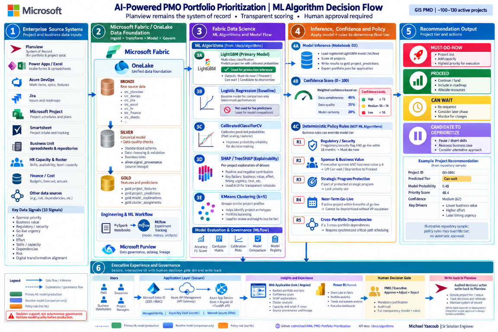
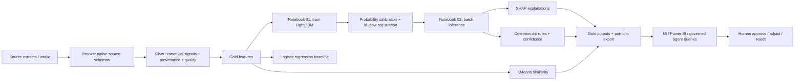

# Architecture: governed Fabric evidence and ML flow

## ML algorithms, end to end


The supplied walkthrough is illustrative, not a live inference result. Its
example probabilities, model-consensus confidence, and Planview update steps
must not be interpreted as the implemented scoring formula or deployed write-back.



The notebooks are the implementation authority:

- [Notebook 01](../fabric/ml-notebooks/01-feature-engineering/01_PMO_Feature_Engineering_Training.ipynb):
  normalize observed source signals, record provenance and quality, engineer
  features, compare logistic regression, train and calibrate LightGBM, and
  track metrics and artifacts in MLflow.
- [Notebook 02](../fabric/ml-notebooks/02-inference-predictions/02_PMO_Inference_Predictions.ipynb):
  load the trained model, infer tiers and probabilities, persist explanations,
  apply confidence/policy logic, group similar projects with KMeans, and export
  application evidence.
- Logistic regression is a baseline, not an additional production vote.
  SHAP attribution explains model behavior; it is not causal evidence.
  KMeans similarity does not determine the priority tier.
- Confidence combines completeness (45%), data quality (35%), and model
  certainty (20%). Policy rules are deterministic, not ML.
- Human review remains mandatory. Planview write-back, external source
  connectors, and user-specific authorization are not established by these images.



## Foundry agents and tool execution

Three agents run in the `pmo-portfolio` Foundry project, all on `gpt-5.6-sol`.
`pmo-portfolio-copilot` answers portfolio chat from OneLake only.
`pmo-recommendation-agent` recommends new projects and changes to existing
projects from OneLake and public web sources. `pmo-intake-agent` prefills Quick
Add fields from public web sources. The sequence below shows the chat path, and
the other two follow the same pattern. Foundry runs the tools that each agent is
configured with, and the backend validates the reply against the evidence it
retrieved. Bing grounding runs inside Foundry and does not pass through APIM. The
API rejects a prefill or recommendation reply unless Bing was called, and it rejects
a project citation that the OneLake tool did not return.

### Chat: native Foundry MCP tool execution

```mermaid
sequenceDiagram
    participant U as UI
    participant G as Application APIM API
    participant O as Backend orchestrator
    participant F as Foundry agent
    participant T as Private APIM MCP server
    participant Q as Read-only query adapter
    participant L as Fabric OneLake
    U->>G: Chat question (no snapshot)
    G->>O: Forward chat
    O->>F: Question + bounded history; require query_portfolio
    F->>T: query_portfolio + project managed identity bearer token
    T->>T: Validate JWT issuer/audience/caller/role
    T->>Q: Forward authenticated bounded query
    Q->>Q: Validate token again
    Q->>L: Read approved portfolio export
    L-->>Q: Export (existing 120-second cache applies)
    Q-->>T: Selected fields/rows + source/query IDs
    T-->>F: MCP tool result, not the full export
    F-->>O: MCP call evidence + structured answer
    O->>O: Validate shape and citations against retrieved evidence
    O-->>U: Answer + Foundry response ID + APIM query IDs
```

This implementation uses **native Foundry MCP execution**. APIM exports the
bounded portfolio REST operation as `query_portfolio` at `pmo-onelake/mcp`.
It is a solution-specific OneLake MCP server, not Fabric Core MCP or Fabric's
general-purpose data-agent service. The adapter reads approved persisted Fabric
outputs; Foundry neither trains models nor changes project data. AI Search is
not used for exact ranking, budget aggregation, or capacity evidence.

### Enforced controls

- Explicitly allowlisted PMO project managed identity and legacy API tool identity.
  No Fabric permissions are granted to that identity; the adapter uses the
  existing backend OneLake identity. Its only new permission is `Portfolio.Query`
  on a dedicated single-tenant Entra API application.
- Separate `pmo-tools` REST API and `pmo-onelake` MCP API, not part of the browser API product. No shared
  subscription key is required: Entra workload authentication is mandatory.
  The query endpoint repeats signature, expiry, issuer, tenant, audience,
  object ID, and app-role checks to prevent a direct-backend bypass.
- No arbitrary SQL, arbitrary file paths, arbitrary URLs, mutation tools, or
  browser-supplied snapshots. Exact-match filters, server projections,
  deterministic budget aggregation, at most 25 rows/query, and four calls/answer.
- Every answer must retrieve current evidence; history is not a source of truth.
  The orchestrator checks cited project IDs against tool-returned IDs.
  This does not guarantee every generated sentence is factually correct.
- Only the trusted read-only MCP tool is approved automatically. Errors are explicit;
  no sample fallback. Overall inference budget is 90 seconds; APIM backend requests at most
  30 seconds. Gateway rate limit: 60 calls/minute.
- Logs contain response/query identifiers, not tokens or full datasets.
  The Fabric export can still contain generated demo data.

### Private-enterprise deployment boundary

Keep APIM public access disabled. Configure API outbound VNet integration,
private DNS, routing, and private endpoints for the actual Fabric and Foundry
services. Verify each required endpoint with public access blocked. An inbound
Foundry private endpoint alone does not isolate its outbound tool traffic.
The dedicated PMO project runs on the existing VNet-injected
`foundry-myaacoub-private` account so Foundry can reach private APIM itself.
The project template does not change the shared account's public-access settings.

This release does not automatically convert existing public UI/API/Foundry/Fabric
endpoints to private endpoints. End-user Entra SSO, Conditional Access, delegated
authorization/RLS, and complete private ingress/egress are separate production
gates. The current tool is for one approved application-wide dataset, not
per-user entitlements. Do not use it for differently entitled users without
adding a trusted caller authorization context and enforcing it before retrieval.

## OneLake dataset API for the UI

The UI reads and writes OneLake through `/v1/onelake`, not directly. The allowlist
is [config/onelake-datasets.json](../config/onelake-datasets.json). A client names a
dataset by key and cannot supply a path. A write to an existing dataset must send
the ETag from its last read in `If-Match`. A change made since then returns 409 and
is not overwritten. Each write is checked for shape, required fields, and size before
anything is stored. Admin system settings and priority weights are the two
`readWrite` datasets, and their admin endpoints read and write the same tables.
OneLake errors are reported to the caller and never replaced by defaults.

## Provision and verify

1. Review [the scoped tool configuration script](../infra/scripts/configure-agent-tools.ps1)
   without `-Apply`. With approval, use `-Apply` to configure the dedicated
   identity, Entra permission, API VNet integration, JWT policies and app settings.
   It refuses an APIM gateway with public access enabled and does not change
   public-access settings. Existing mismatched registrations fail explicitly.
2. Provision the dedicated project using [agent-project.bicep](../infra/bicep/agent-project.bicep).
   Pass its resource ID to the tool configuration script; it creates a keyless
   project-managed-identity connection and grants `Portfolio.Query`.
   Create the Grounding with Bing Search connection with
   [the Bing connection script](../infra/scripts/create-bing-connection.ps1), then
   create the pinned immutable Foundry versions using
   [the agent provisioning script](../infra/scripts/create-portfolio-agent.ps1)
   (`-CreateNextVersion` is required only when an agent already exists).
   APIM shares the validated query schema with the API.
3. Publish API and UI with [the existing deployment script](../infra/scripts/deploy.ps1)
   in `publish` mode only. Do not apply the unrelated full-infrastructure drift.
4. Run [the opt-in live test](../api/tests/test_agent_live.py) through the UI
   proxy. Verify project IDs, score order, agent version, Foundry response ID,
   and APIM query IDs. Test unauthenticated and wrong-caller tool requests.
5. Verify private DNS, routing and public-access denial separately in the target
   enterprise environment. Successful application calls alone are not proof of
   complete network isolation.

References: [Foundry networking](https://learn.microsoft.com/azure/foundry/agents/concepts/networking-options),
[Fabric Private Link](https://learn.microsoft.com/fabric/security/security-private-links-overview),
[Fabric data-agent MCP](https://learn.microsoft.com/fabric/data-science/data-agent-mcp-server).
