# AI-Powered PMO Portfolio Prioritization — User Guide

Welcome to the **AI-Powered PMO Portfolio Prioritization** solution user manual. This platform integrates 11 disparate project management and business systems (Planview, Power Apps, Azure DevOps, JIRA, MS Project, Smartsheet, BU Trackers, HR Capacity, HR Roster, Finance, and Excel intake) into Microsoft Fabric OneLake, applies transparent Machine Learning (LightGBM + SHAP) and business rule governance (R1 to R5), and provides a high-fidelity, device-optimized interface for executives, PMO directors, and portfolio managers.

---

## Table of Contents

1. [Executive Portfolio Overview](#1-executive-portfolio-overview)
2. [Multi-Device Layout Optimization](#2-multi-device-layout-optimization)
3. [Prioritization Board & Table](#3-prioritization-board--table)
4. [Organizational Hierarchy & Rollups](#4-organizational-hierarchy--rollups)
5. [Executive Analytics](#5-executive-analytics)
6. [Quick Add with AI Prefill](#6-quick-add-with-ai-prefill)
7. [Data Entry, Imports & Demo Controls](#7-data-entry-imports--demo-controls)
8. [PMO Decisions & Human Governance Log](#8-pmo-decisions--human-governance-log)
9. [Project Deep Dive & SHAP Drivers](#9-project-deep-dive--shap-drivers)
10. [AI Portfolio Copilot (Agent FAB & Multi-Format Exports)](#10-ai-portfolio-copilot-agent-fab--multi-format-exports)

---

## 1. Executive Portfolio Overview

The **Overview** screen brings together project priorities, confidence, estimated investment, and resource needs for the current portfolio.

Portfolio data comes from the database. While the Demo Environment setting is on (Admin Settings), every page shows a banner saying the data is synthetic demo data. Operational screens use business terminology; Architecture and Agents documentation explain the underlying technologies.

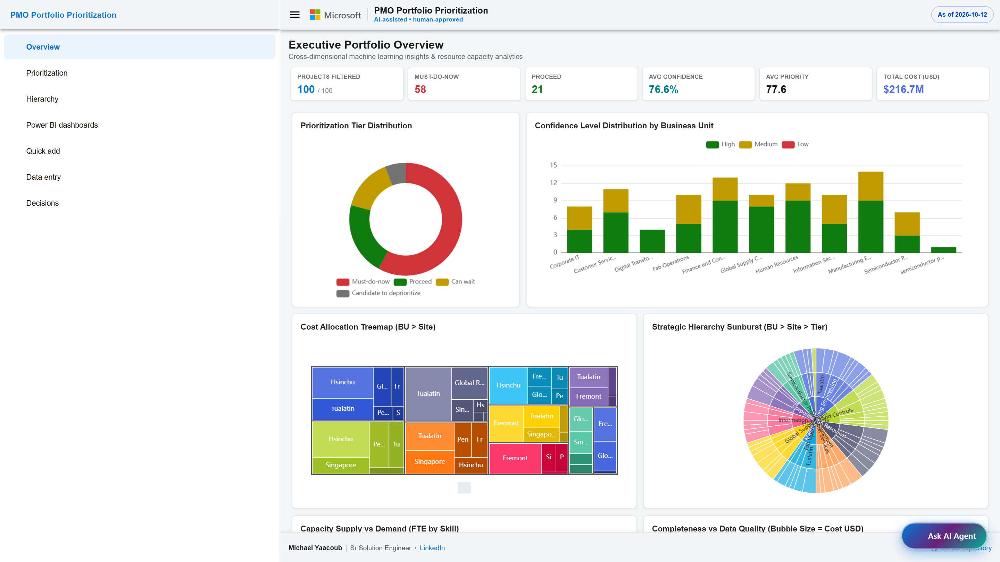

### Key Capabilities:
- **Executive KPI Cards**: Rollups of filtered project counts, priority tiers, confidence, priority scores, and estimated cost.
- **Project Priority Mix**: Counts projects in *Must-do-now*, *Proceed*, *Can wait*, and *Candidate to deprioritize*. Slice size is project count, not budget.
- **Priority Confidence by Business Unit**: Shows the number of High-, Medium-, and Low-confidence project assessments in each business unit. Confidence is not business value.
- **Planned Investment by Business Unit and Site**: Larger rectangles represent higher estimated project cost; these are not actual spending figures.
- **Priorities Across Business Units and Sites**: Rings show business unit, site, and priority tier, sized by project count.
- **Available Capacity vs Project Demand**: Compares saved portfolio-wide staffing supply and demand by skill. Unlike the project charts, these totals do not change with project filters.
- **Project Information Readiness**: Each circle is a project; horizontal position shows completeness, vertical position shows quality, size indicates estimated cost, and colour shows confidence.

Every chart includes a one-sentence explanation directly beneath its title. Select **More detail and an example** to expand reading guidance and a practical example; select it again to collapse. The controls also work with a keyboard. Examples are explicitly labelled as illustrative, not live portfolio results. All six chart titles and explanations are editable in [overview-charts.json](../ui/src/assets/config/overview-charts.json).

---

## 2. Multi-Device Layout Optimization

The application is engineered with an adaptive, fluid architecture delivering a cohesive experience across **Browser**, **Desktop**, **Tablet**, and **Mobile** viewports:

| Device Class | Viewport Range | Optimized Experience |
|---|---|---|
| **Desktop / Large Displays** | 1200px – 4K | 3-column split-pane layout: collapsible left navigation, active filter sidebar, interactive central workspace, and sliding project detail inspector. |
| **Tablet / Foldables** | 768px – 1199px | 2-column adaptive layout: collapsible side menu drawer, 2x2 responsive KPI grid, touch-friendly chart tooltips, and floating filter controls. |
| **Mobile Smartphones** | 320px – 767px | Single-column fluid stack: touch-accessible navigation bar, bottom-sheet slide drawers for filters and details, thumb-friendly tap targets, and swipeable board cards. |

  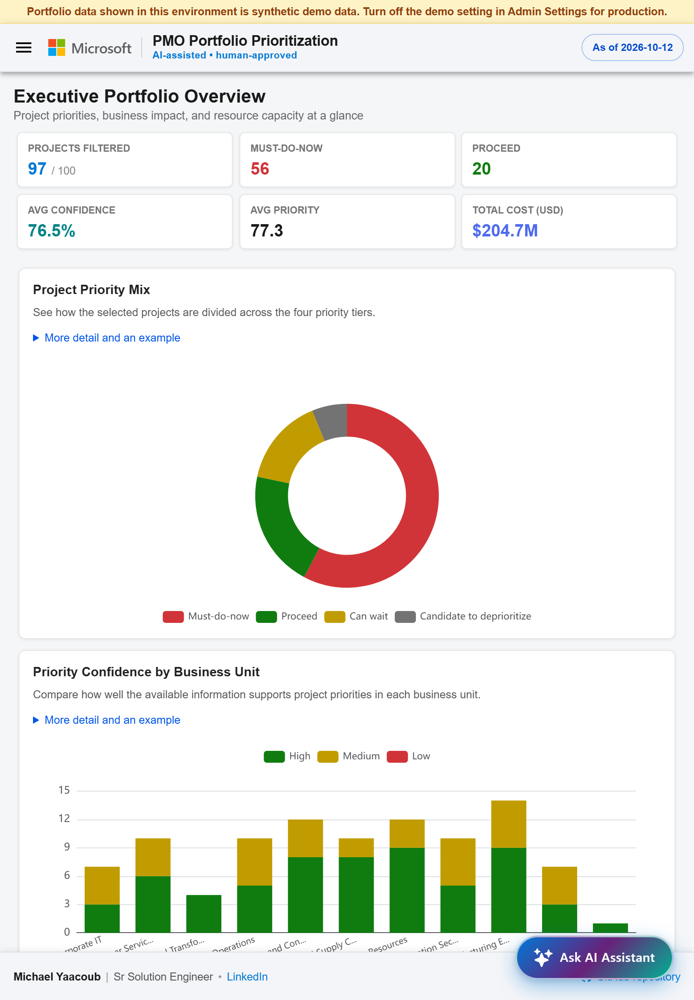
  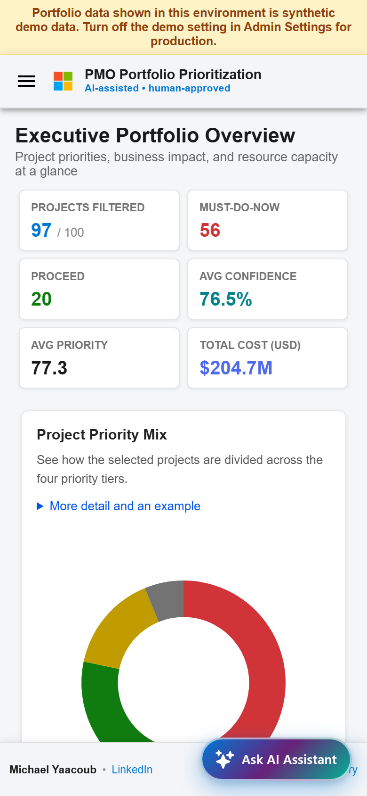

---

## 3. Prioritization Board & Table

The **Prioritization** workspace provides multiple lenses to examine, rank, and group all 100 projects in the portfolio:

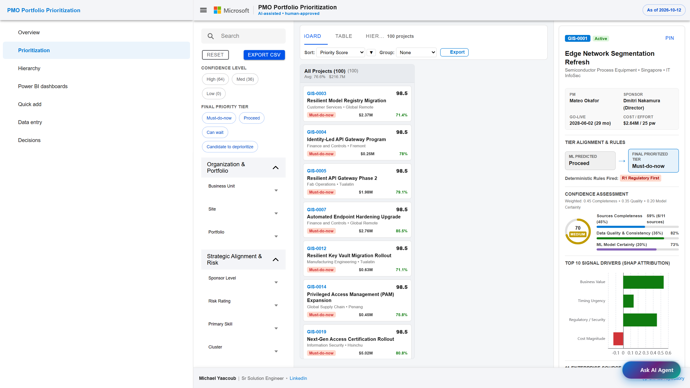

### Board View:
- Displays cards grouped by **Final Tier** (*Must-do-now*, *Proceed*, *Can wait*, *Candidate to deprioritize*) or customizable Group-By dimensions (*Confidence Level*, *Business Unit*, *Cluster*, *Action Lever*).
- Each project card displays the unique **GIS-####** identifier, project name, business unit, site, priority score badge, cost estimate, and confidence pill.
- Star icon toggle allows pinning key projects to an executive shortlist.

### Table View:
- High-density data grid featuring sticky headers, sortable columns (Priority Score, Project Name, Tier, Confidence, Cost, Go-Live Date, Sources Present, and Action Lever).
- Client-side pagination (10, 25, 50, 100 rows per page) and real-time faceted search filtering.

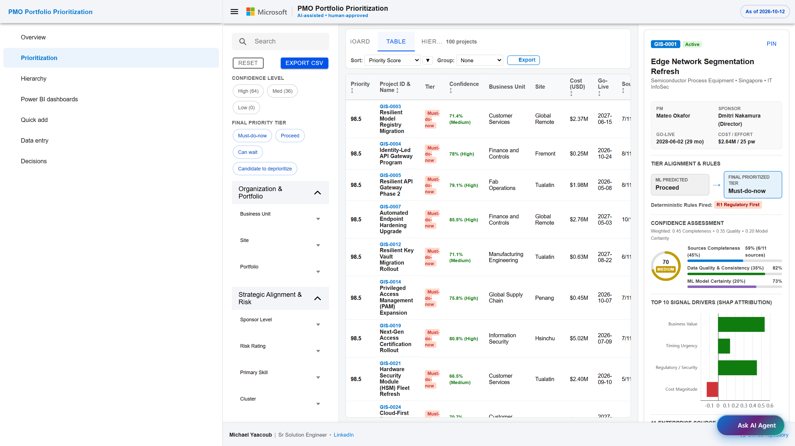

### Multi-View Pagination & Trash Access:
- **Synchronized Pagination**: Both Board and Table views feature synchronized pagination controls at the bottom of the workspace. Select from 10, 25, 50, or 100 projects per page, with Prev/Next, direct first/last jump, and accurate item count indicators (e.g. *Showing 1–25 of 100 projects*).
- **Direct Edit Links**: Each project card in Board view and each row in Table view includes an **Edit** action linking directly to the URL-based project edit screen.
- **Trash Access**: A **Trash (N)** button in the workspace toolbar shows the live count of soft-deleted projects and provides instant access to the Trashed Projects screen.

---

## 3.1. Trashed Projects & Audit Lifecycle (`/trash`)

The **Trashed Projects** view (`/trash`) provides a dedicated management workspace for projects that have been soft-deleted from the portfolio:

- **Soft-Delete Safety**: Deleting a project removes it from active prioritization, hierarchy, and executive views while preserving its record in OneLake for audit compliance.
- **One-Click Restore**: Click **Restore** on any project to immediately return it to active portfolio prioritization.
- **Restore All**: Bulk action to restore all soft-deleted projects simultaneously.
- **Confirmed Permanent Purge**: Click **Delete** or **Empty Trash** to permanently purge projects from the database. A confirmation modal guards against accidental deletion.
- **Search & Filter**: Quickly find trashed projects by ID, name, portfolio, or executive sponsor.
- **Back to Prioritization**: Seamless top navigation returns you to the active portfolio workspace.

---

## 4. Organizational Hierarchy & Rollups

The **Hierarchy** view provides aggregated rollups structured by **Business Unit &gt; Site &gt; Project**:

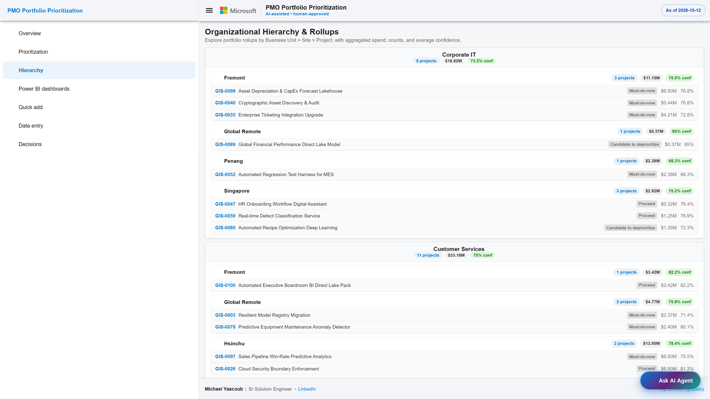

### Key Features:
- **Interactive Collapsible Tree**: Expand and collapse individual Business Units and Sites.
- **Aggregate Metrics**: Every node displays total project count, total capital commitment ($M), and weighted average confidence score.
- **Direct Project Selection**: Clicking any child project immediately selects it for detailed inspection.

---

## 5. Executive Analytics

Open **Executive Analytics** for the **Portfolio Dashboard** and **Published Reports** views. The dashboard summarizes saved project records from the database. Published reports are available only after your reporting team publishes them and grants your account access.

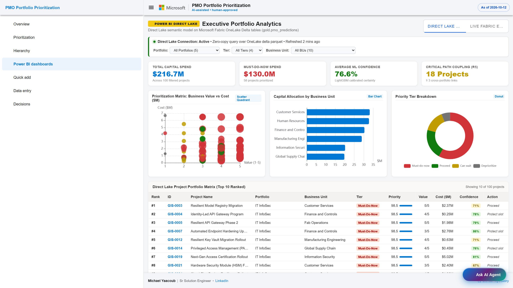

### Key Features:
- **Saved Analysis**: Displays the date of the underlying project analysis; it does not claim that scores are being recalculated live.
- **Interactive Slicers**: Filter across Portfolios, Priority Tiers, and Business Units simultaneously.
- **Prioritization Scatter Matrix**: Quadrant analysis comparing Business Value (1-5) against Estimated Cost ($M).
- **Top 10 High-Impact Matrix**: Live ranking table with conditional mini-bars illustrating relative priority scores.
- **Published Reports**: Use **Sign in to view reports** to access a published report. Missing reports or access restrictions are shown explicitly; the Portfolio Dashboard remains available.

---

## 6. Quick Add with AI Prefill

The **Quick Add** wizard allows business sponsors and PMs to submit project proposals in plain English and have the Microsoft Foundry intake agent fill the project fields:

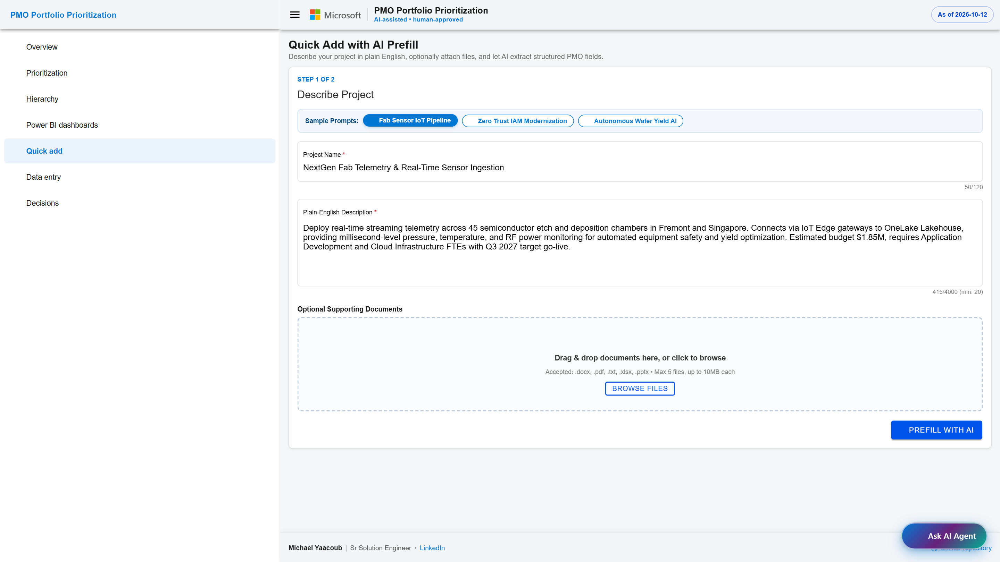

### Workflow:
1. **Describe the project**: Enter the project name and a plain-English description. Every field starts blank.
2. **AI Pre-fill (Missing only)**: the intake agent fills the fields that are still empty, using public web sources through Bing grounding. It covers Business Value, Regulatory Flag, Primary Skill, Cost Estimate, Risk Rating, and Effort person-weeks. A value you entered is never replaced.
3. **Signal Provenance & Confidence**: Each field displays an extracted confidence score, evidence quote from the source text, and allows human overrides before OneLake submission.

---

## 7. Data Entry, Imports & Demo Controls

The **Data Entry** page supports project and portfolio creation and the **Import & Uploads** tab.

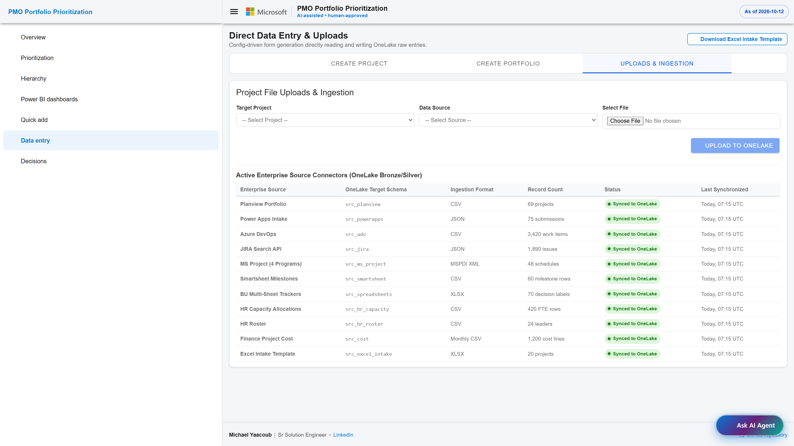

### Key Capabilities:
- **Create Project**: Form-based creation. Every field starts blank, and numbers are never filled with example values.
- **Dropdown suggestions**: when the AI proposes a Portfolio, Business Unit, or Site that its list does not have (for example, a new portfolio "HR Projects" for an HR policies website), the form shows the proposal under the dropdown. **Create and apply** adds it to the list and sets the field in one click; a new portfolio gets one program with the same name. **Dismiss** hides the proposal. A dropdown is never set to a value its list does not show.
- **Program**: lists the programs of the selected portfolio. Changing the portfolio clears a program that belongs to another portfolio.
- **Create Portfolio**: Register new portfolios and program taxonomies.
- **Import Excel**: Upload a workbook that follows the import template. Download the template from the same screen; its *Allowed values* sheet lists the portfolios, programs, skills, and statuses the workbook must use. Every row is checked first. If any row is invalid, nothing is saved and each problem is listed by row and column (for example, row 4, Sponsor). A valid workbook saves its projects and starts a pipeline run, so scores and dashboards update when the run finishes.

### Saving a project

1. Enter a project name of 3 to 120 characters. Scope and description are saved
   as the project's Notes, with a 1,000-character limit. Description is optional
   for manual entry, but AI prefill needs enough description to understand the work.
2. Select a Portfolio and then one of its Programs. Complete Business Unit, Site,
   Executive Sponsor, Sponsor Level, Status, Risk Rating and Primary Skill.
   For new work, use Planning or Backlog.
3. Enter Business Value as a whole number from 1 to 5; User Base as a whole number
   from 0 to 100,000,000; a Go-Live Date from 2026-01-01 to 2032-12-31; Skill Demand
   from 0.5 to 12 FTE; Cost Estimate from 10,000 to 100,000,000 USD; and **Effort**
   from 1 to 2,000 person-weeks. Effort is required, not optional.
4. Select **Save & Submit Project**. Missing or out-of-range entries are listed
   by field name. Any additional server checks show their field-level reasons;
   entered values remain in the form so they can be corrected and resubmitted.
   An assigned project ID confirms that the record was created. Start and completion
   dates are recorded separately from project details.

The API remains the authority for current allowed values and limits. The form
reads those limits from its shared field definitions rather than inventing replacements.

### Demo project controls

When **Demo Environment** is enabled, **Import & Uploads** also provides:

- **Load all demo projects**: Replace the current project set with the approved 100-project synthetic snapshot.
- **Load a portfolio**: Replace projects only within the selected portfolio using its approved demo subset; other portfolios are preserved.
- **Clear all projects**: Remove the current projects from the application's active view without deleting the original source or decision history.

Each operation shows an explicit confirmation. Repeated loads do not create duplicates. If a demo project was moved to another portfolio, a portfolio-only load stops with an explanation rather than changing that other portfolio. These controls disappear outside demo mode, and the server also refuses them.

Demo loading reuses the snapshot's recorded priorities and scores; it is not a new analysis run. Old resource totals and capacity scenarios are unavailable after a reset rather than being shown against the wrong projects. The current analysis pipeline does not yet incorporate these reset/lifecycle overlays.

### AI Recommendations

Opening **AI Recommendations** starts two independent requests: one retrieves the last saved report for the chosen portfolio and question; the other asks the recommendation assistant for a fresh report. You can read the saved report, with its original generation time, while the refresh runs. A successful fresh report replaces it and is saved to the database. If the refresh fails, the saved report remains visible with an error and retry option.

Recommendations focus only on genuinely new opportunities and confirmed **not-started** projects.
Started, on-hold and completed work is a protected commitment, not a candidate to stop,
replace or deprioritize. The assistant can read the full project register, including
pending and committed projects, to compare opportunities with work that already exists.
It considers purpose and scope; the server additionally blocks matching names after
normalizing case, punctuation and spacing. A semantic comparison is not a guaranteed
automatic duplicate detector.

Portfolio choices use their saved identifiers, and changing portfolio clears the previous portfolio's report.
Progress, project, priority-weight and demo-reset changes invalidate incompatible saved reports.
If records change during a review, refresh instead of applying an outdated recommendation.
Every action is checked again at approval time and still needs an explicit human click.

---

## 8. PMO Decisions & Human Governance Log

The **Decisions** screen enforces the proposal principle: *"Keep people in control."* Every AI recommendation must be approved, adjusted, or rejected by human stakeholders:

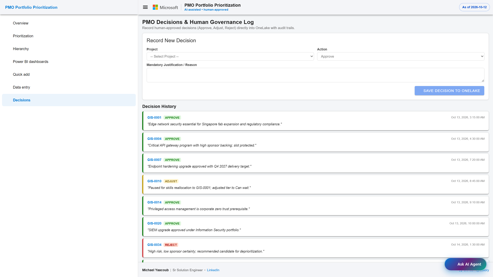

### Features:
- **Record Governance Action**: Choose the action (*Approve*, *Adjust*, *Reject*), the project, the priority tier (it defaults to the project's current tier), who decided ("Decided by"), and a mandatory justification.
- **Latest decision in the detail panel**: Opening a project shows its most recent decision with its action, tier, decider, and justification.
- **Immutable Audit Trail**: Chronological log recording reviewer timestamps, action pills, and justification notes stored in OneLake.

---

## 9. Project Deep Dive & SHAP Drivers

Clicking any project opens the **Detail Inspector** displaying all 10 canonical signals, machine learning explainability, and rule overrides:

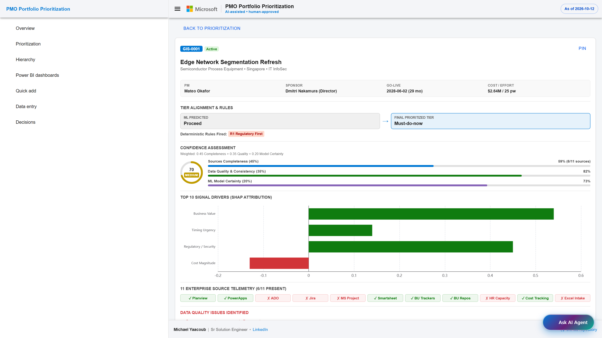

### Key Elements:
- **Confidence Ring Gauge**: Visual breakdown of Completeness, Quality, and Model Certainty.
- **SHAP Feature Importance Waterfall**: Explains *why* the model scored the project high or low (e.g. high business value increasing score by +0.72; high cost reducing score by -0.18).
- **Record start / progress**: Confirm whether work has started and record its actual start and estimated finish dates. The start cannot be in the future, and the estimated finish cannot precede the start. A past estimate is allowed for overdue work.
- **Update progress / complete**: Update the estimate, or mark the project complete with its actual completion date. A completion date must fall between the start date and today. Started work cannot go back to the not-started queue; completed work cannot be reopened.
- **Legacy and pending projects**: Existing Active, On Hold and Completed records stay protected even when dates have not been recorded. Missing dates are shown as not recorded, never invented. Unknown progress needs confirmation. A newly created project links directly to its progress screen even before analysis is available.
- **Other lifecycle actions**: *Mark as Backlog* is available only before work starts. *Soft Delete (Trash)*, *Restore*, and confirmed *Permanent Delete* still persist through the API.
- **Edit Project**: Changes to project inputs save through the API. Use the progress action, not the status dropdown, to start or complete work. Recorded tiers, confidence and explanations remain read-only. Priority scores also reflect the currently saved priority weights.
- **Rule Overrides Badge**: Transparent indicators showing which deterministic business rules (R1 Regulatory First, R2 Executive Sponsorship, R3 Protected Programs, R4 Deprioritize Guard, R5 Cross-Portfolio Critical Path) altered the machine learning rank.
- **Cross-Source Provenance**: Checkmarks showing which of the 11 enterprise systems contributed data.

### Organization, portfolio and project priority settings

Open **Admin → Priority Weights**. Configure global defaults, select a portfolio
to set its own weights, or set an individual project override. Precedence is
**project → portfolio → organization defaults**. A partial override inherits
the remaining fields; clearing an override restores inherited values.

Save applies the policy immediately to existing projects using their saved
analysis, and future analyzed projects inherit the same policy. The editor shows
saved scores rather than pretending an unsaved draft is a live preview.
Conditional saves warn if another person changed the settings first.

The priority score combines 40% of the saved probability-based assessment with
60% of the configurable field score, retaining applicable rule minimums.
Weights do not retrain the prediction, change its tier/confidence, or rewrite
its explanations. Projects with insufficient saved analysis are explicitly
labelled; they are not assigned invented scores.

The screenshots and printable PDF above are earlier captures; the current
in-app controls and this Markdown guide describe the updated workflow.

---

## 9.1. URL-Based Project Edit & Calculation Transparency (`/projects/:projectId/edit`)

The **Edit Project** screen is accessible via a dedicated, deep-linkable URL (`/projects/:projectId/edit`) with a **Back to Prioritization** navigation button, replacing popups with a full-screen executive workspace:

### 1. Field-Level AI vs. Human Provenance
Every field on the edit form displays a visual provenance badge:
- **AI-Prefilled / Inferred**: Purple sparkle badge (`✨ AI (XX%)`) showing the exact model confidence score (e.g. *85%*). Hovering reveals a detailed tooltip explaining the extraction rationale and source document citation.
- **Human-Entered**: Blue badge (`👤 Human`) indicating values provided directly by the project sponsor or PM.
- **Dynamic Provenance**: Editing any field immediately updates its badge to *Human* (100% confidence), reflecting user modifications.

### 2. Supporting Document Attachments & AI Recalculation
- **Attach Documents**: Upload project charters, business cases, architecture specifications, or risk registers (`.pdf`, `.docx`, `.xlsx`, `.txt`, `.md`, `.csv`, `.json`). Files persist into OneLake storage under the project's folder.
- **Attached Documents Catalog**: Inspect uploaded files with file size, upload timestamps, and OneLake ingestion status.
- **AI Recalculation Engine**: Click **Recalculate with AI** to trigger the Foundry agent to analyze all attached documents, extract updated signals (business value, scope urgency, risk, effort, FTE demand), update editable fields, and recalculate priority scores and tier rankings.

### 3. Full Calculation Transparency & ML Methodology Tab
A dedicated **Calculation Transparency & ML Methodology** tab explains how every single calculated field is derived:
- **Final Priority Score (Hybrid)**:
  - **40% Machine Learning Base Score**: Computed by **LightGBM Multi-Class GBDT Classifier** with Platt Scaling calibrated probabilities across the 4 tiers:
    `ML Base = (1.0 × P_MustDo + 0.7 × P_Proceed + 0.35 × P_CanWait + 0.0 × P_Deprioritize) × 100`
  - **60% Field Weighted Score**: Multi-Criteria Decision Analysis (MCDA) weighted sum across 11 normalized dimensions, applying active priority weights (Project > Portfolio > Global).
  - **Blended Score**: `round(0.4 × ML_Base + 0.6 × Field_Weighted, 1)`.
  - **Governance Rule Floors**: Evaluates whether Rule R1 (Regulatory Floor 85), Rule R3 (Protected Program Floor 80), or Rule R2 (Strategic Alignment Floor 75) overrides the score.
- **Field Weighted Score (Deterministic)**: MCDA weighted sum breakdown table showing raw project inputs, normalized scores (0–100), and effective percentage weights for Business Value, User Base, Regulatory, Urgency, Sponsor Priority, DT Alignment, Risk, Cost, Dependencies, Effort, and Skill Demand.
- **Suggested Priority Tier (ML Tier)**: **LightGBM Classifier** predicting class probabilities and TreeSHAP drivers.
- **Confidence Score & Level**: **Random Forest Ensemble Variance & Multi-Source Data Completeness Model** evaluating missingness across 11 integrated systems (`Sources_Present / 11`) and Shannon entropy.
- **Strategic Cluster**: **K-Means Clustering with PCA (k=4)** grouping projects by resource and technology profile.
- **Recommended Action**: Deterministic Business Rules Decision Matrix.
- **Months to Go-Live**: Deterministic date calculation `(TargetGoLive - AsOfDate) / 30.4375`.

---

## 10. AI Portfolio Copilot (Agent FAB & Multi-Format Exports)

The **AI Portfolio Copilot** is accessible from any screen via the Floating Action Button (FAB) in the lower-right corner:

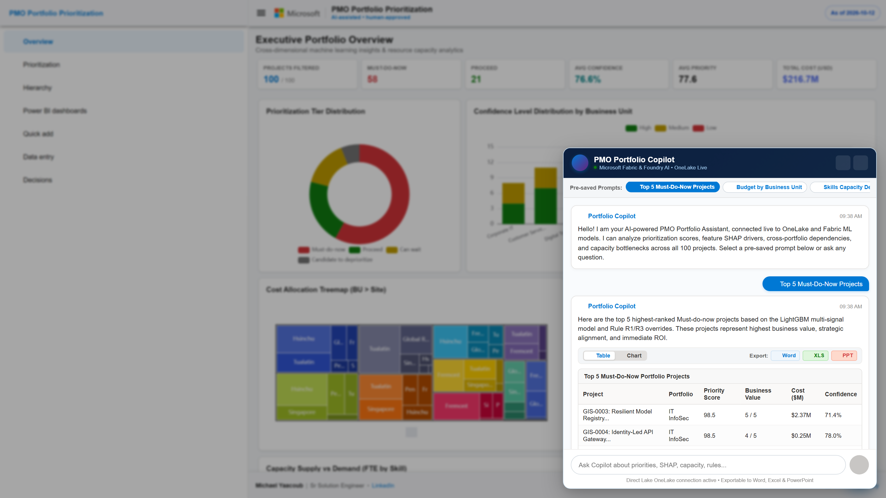

### Copilot Features:
- **Pulsing FAB**: High-visibility floating button with gradient styling and "Ask AI Agent" indicator.
- **Pre-Saved Prompts**: Clickable chips that send real requests to the Foundry agent. The list is set in `ui/src/assets/config/ui.json` under `copilot.samplePrompts`:
  - 💡 *Top 5 Must-Do-Now Projects*
  - 📊 *Budget by Business Unit*
  - 👥 *Skills Capacity Deficits*
  - 🔍 *Explain the Top Project*
  - 🛡️ *Regulatory & Security Projects*
  - ⚡ *Cross-Portfolio Dependencies*
- **Table vs Chart Switcher**: Seamlessly toggle any Copilot response between a structured data table and an interactive chart.
- **Chart Type Selector**: Switch between **Bar**, **Line**, **Pie / Donut**, and **Radar / Spider** charts with a single click.
- **Multi-Format Export**: Export any Copilot answer directly to:
  - 📄 **Word (.docx)**
  - 📊 **Excel (.xlsx)**
  - 📑 **PowerPoint (.pptx)**
- **Verifiable Responses**: Successful answers show the Foundry agent name,
  version, response ID, and source project IDs. The agent uses a server-read
  read-only OneLake query tools through APIM, not browser-generated answers or
  a full portfolio snapshot in the prompt. Query IDs identify the retrieval.
- **Explicit Errors**: If the snapshot is missing or the agent is unavailable,
  the drawer shows an error instead of substituting demo results. Retry after
  the upstream issue is resolved.

Responses depend on the evidence present in the snapshot. Missing SHAP,
dependency, or capacity evidence is reported as unavailable. The agent does not
approve decisions or change project records. Charts and exports are available
when the answer includes a data table.

### ML flow diagrams

The **Architecture & Steps** page opens on **Solution Architecture**, with the
architecture diagram, layer descriptions and governed Foundry query path.
Its second tab, **ML Algos**, contains both ML flow diagrams. **Pipeline Steps**,
**OneLake Layers**, and **Services & Security** keep the detailed reference
sections separate. The tab bar scrolls horizontally on narrow screens.

The **Documentation → Architecture** and **Documentation → Algorithms** screens
include both diagrams with full-resolution links:

These are illustrative explanations, not live outputs. Example confidence,
model consensus, and write-back are not implementation guarantees. See
[the architecture guide](ARCHITECTURE.md) for actual ML roles and deployment boundaries.

### Project field reference

Open **Documentation → Project Fields**, immediately after Architecture. The
table loads every field from the current intake contract, including data type,
mandatory/optional status, allowed values and limits, an explanation and example.
Search by label, canonical key, or description.

Policy gates appear first, followed by model fields ordered by observed exported
absolute SHAP attribution, then required/optional context fields. Percentages
describe the share of available exported attribution, not a fixed contribution
to priority score or a causal effect. If live attribution is unavailable, the
page states that explicitly and does not invent percentages. The project ID and
pipeline outputs are generated, not additional inputs.

---

*AI-Powered PMO Portfolio Prioritization — Document generated October 2026*
